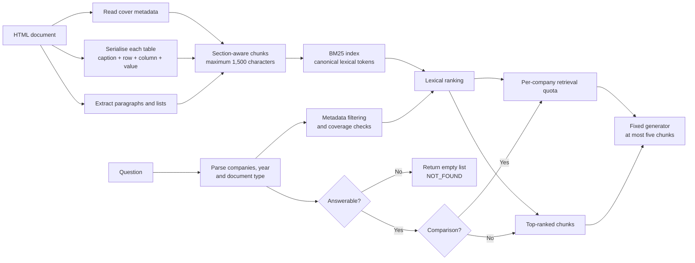

# FTEC5660 Homework 4

## Homework 4 solution

### Pipeline

The parser first obtains the company, fiscal year and document type from the cover, then converts every table row into `row label | column header: value` lines while retaining the caption and units. Narrative paragraphs, lists and table text are chunked by section; every chunk repeats a short company/year/section header, and long tables are split at row boundaries with their caption repeated. At query time, deterministic rules identify all company mentions (including companies absent from the corpus), the named fiscal year and the required document type. Retrieval filters on this metadata before applying BM25 with normalised financial terms, modest query expansion, token-overlap and year tie-breakers. Annual-report lookup prefers the report whose fiscal year equals the question year and falls back to the following report for a prior-year column, which is essential for FY2023. Research forecasts and earnings-call guidance are not incorrectly forced into the document's own FY2025 metadata. Comparison questions reserve evidence slots for each company. The retriever abstains when a company or year is outside the corpus, or when distinctive non-stopword concepts in the question do not occur anywhere in the relevant company/document subset. This last rule is generic rather than a hard-coded list of undisclosed items.

### Ablation study

Run with `python3 ablation.py --data-folder public_test`. Each row adds one component to the preceding row. B0 is the specified naive `get_text()` + recursive splitter + global whitespace BM25 baseline. V7 is the submitted system. Retrieval-only results are measured without an LLM; `--generate` additionally runs the fixed DeepSeek generator and fills in end-to-end accuracy.

| Variant | Component added relative to previous row | Document pass | Parse fields | Recall@5 | Answerable kept | Unanswerable rejected | Abstention score | Answer accuracy |
|---|---|---:|---:|---:|---:|---:|---:|---:|
| B0 | Naive baseline | 100.0% | - | 34.8% | 100.0% | 0.0% | 0.0% | 50.0% |
| V1 | Structured table serialisation | 100.0% | - | 30.4% | 100.0% | 0.0% | 0.0% | 46.7% |
| V2 | Section-aware chunks and contextual headers | 100.0% | - | 82.6% | 100.0% | 0.0% | 0.0% | 85.0% |
| V3 | Query parsing and metadata filtering | 100.0% | 100.0% | 91.3% | 100.0% | 0.0% | 0.0% | 93.3% |
| V4 | Canonical financial tokenisation | 100.0% | 100.0% | 91.3% | 100.0% | 0.0% | 0.0% | 91.7% |
| V5 | Query expansion and distinctive-concept/overlap/year scoring | 100.0% | 100.0% | 100.0% | 100.0% | 0.0% | 0.0% | 98.3% |
| V6 | Per-company comparison allocation | 100.0% | 100.0% | 100.0% | 100.0% | 0.0% | 0.0% | 96.7% |
| V7 | Coverage-based abstention | 100.0% | 100.0% | 100.0% | 100.0% | 100.0% | 100.0% | 100.0% |

All columns were measured on the public set, including end-to-end accuracy from the fixed DeepSeek generator; no accuracy value is estimated. There are 46 answerable and 14 unanswerable questions. The official final run answers all 60 questions correctly and reports **75/75 points** on Tasks 1–4. It makes 46 generator calls, uses 60,160 input and 164 output tokens (estimated cost USD 0.0091), and finishes in 5.0 seconds. As separate checks, `table_to_text` scores 100.0% on all 12 public tables, all 40 documents pass the chunk metadata/probe checks, and the longest final chunk is 1,489 characters. To reproduce, configure a key and run both `python3 hw4.py --data-folder public_test` and `python3 ablation.py --data-folder public_test --generate`.

**Analysis.** B0 confirms the main failure mode of global lexical retrieval: it obtains only 34.8% recall because similarly named companies and different years compete for the same five slots; its 50.0% answer accuracy also shows that a generator cannot reliably recover missing evidence. V1's standalone table conversion is accurate, but recall falls to 30.4% and accuracy to 46.7% when it is inserted into the same global recursive-splitter pipeline. Longer, differently distributed table text changes BM25 document lengths and does not by itself solve entity or year confusion. V2 produces the first large gain (82.6% recall and 85.0% accuracy) by keeping sections and table rows coherent and repeating contextual metadata. V3 raises these to 91.3% and 93.3%, and parses every public query field correctly, by excluding the wrong company, document type and fiscal year. V4 leaves recall unchanged and accuracy decreases slightly to 91.7%: normalising inflections such as `inventories`/`inventory` and `auditor`/`audited` is useful, but tokenisation alone cannot overcome generic words dominating a short query, and a different passage mix can still change a generated answer. V5 reaches 100.0% recall and 98.3% accuracy by adding domain-general synonyms and weighting coverage of distinctive query concepts rather than only generic token frequency. V6 does not change recall but reserves two slots for every company in a comparison, removing a structural retrieval risk. Its 96.7% accuracy, with both remaining errors on unanswerable questions that it never rejects, also demonstrates that perfect retrieval recall is not identical to perfect answering. Finally, V7 rejects all 14 unanswerable questions while retaining all 46 answerable ones, correcting those remaining errors and reaching 100.0% accuracy without any recall loss.

### Error analysis

The final public run has no retrieval misses, false keeps or answer errors: `results.csv` records all 60 answers as correct, with 100% accuracy in every category. Inspection also shows that the first two returned passages contain all required public evidence, although up to five are retained for robustness on unseen wording. During development, the main observed errors were (1) treating `FY2025` as if the year were not bounded by whitespace, (2) missing unknown companies written with a trailing apostrophe rather than `'s`, (3) allowing the generic verb `hold` to trigger an undisclosed-concept rejection, and (4) letting long business-overview chunks outrank the balance-sheet row for inventory questions because both shared many generic terms. The fixes are structural—year extraction, entity anchors, stopword treatment and distinctive-concept weighting—not public-answer lookups. The ablation additionally shows two generation-side lessons: exact evidence must outrank rounded narrative values, and abstention is necessary even when answerable-question recall is already perfect.

The remaining private-set risk is paraphrase sensitivity in abstention: a valid question whose distinctive term is absent from the document and is not covered by the canonical token rules could be rejected. Conversely, an undisclosed concept expressed entirely with common words could pass the coverage check. The five-chunk limit also means that unusually weak lexical ranking could still omit one side of a comparison despite the quota. Although the public generator correctly selects exact table values and new rather than previous forecasts, those behaviours should still be monitored on unseen companies and wording; the 100% public score is not assumed to guarantee a perfect private-set score.

### Implementation notes and reproducibility

- Only the five requested functions and helpers above the provided-code line in `hw4.py` are used for the solution. The fixed generator and runner are unchanged.
- No embeddings, external data, cached index, hard-coded company names, file names, questions or answers are used.
- `table_to_text` and `chunk_document` are entirely deterministic and make no model calls.
- Install with `pip install -r requirements.txt`, put `DEEPSEEK_API_KEY=...` in a local `.env`, and run `python3 hw4.py --data-folder public_test`. Do not commit `.env`.
- `ablation.py` writes `ablation_results.csv` and `retrieval_results.csv` without a key. With `--generate`, it writes `results.csv` including generated answers and correctness.

## Reflection

In a world where capable personal AI agents are universal, I would want to be a person who exercises judgement rather than merely produces output. If writing, programming and research become inexpensive, the scarce part of any decision will be choosing what deserves attention, understanding its consequences, and taking responsibility for it. I would want to remain curious enough to question an agent's answer, honest enough to distinguish confidence from evidence, and brave enough to make a decision when the information is incomplete. I do not want my relationship with AI to become a convenient way of avoiding thought.

My ambition to build a career in finance, particularly in structuring, would still matter, but its meaning would change. I would not see my value as coming from remembering more formulas or producing a presentation faster than someone else. An agent could do both. The ambition that remains important is understanding why a solution fits a client's actual constraints, what risks are being transferred, and whether the apparent elegance of a structure hides a fragility. Technical competence would still matter because I cannot challenge a model's assumptions if I do not understand them. However, competence would be a foundation for judgement, not a substitute for it.

Beyond productivity and professional achievement, I would want to be known as someone who is dependable, fair and willing to tell the truth without humiliating other people. In finance especially, trust is not a decorative quality: it determines whether people share the inconvenient information needed to make a good decision. I would also want to be remembered for helping others develop, for keeping my word when circumstances become inconvenient, and for treating people who have little power with the same seriousness as people who have a great deal. None of these can be delegated to an agent acting in my name.

I am willing to struggle for independent understanding, difficult conversations and long-term relationships. AI can explain a concept patiently, but I still want the discomfort of reconstructing an argument myself and discovering where my reasoning fails. AI can draft a diplomatic message, but it cannot accept responsibility on my behalf when I need to apologise, disagree or set a boundary. It can simulate companionship, but real friendship requires attention, shared experience and the freedom of another person to surprise me. I am also willing to struggle for physical and cultural experiences—travel, sport, learning from people in person—because a polished summary is not the same as having been present.

The skills and qualities that would still make me valuable are problem formulation, verification, synthesis across domains, communication, ethical judgement and the ability to create trust. I would also add adaptability: not chasing every new tool, but learning enough to decide when a tool should be used, checked or rejected. Experience would matter because unusual situations rarely announce which textbook assumption they violate. My value would increasingly lie in connecting a technically correct answer to human purposes and constraints.

If my value is no longer determined primarily by what I can do, I would define myself by what I choose to care about, what I refuse to compromise, and how I treat others over time. Identity would be less like a list of capabilities and more like a pattern of commitments. Tomorrow, I should start using AI more deliberately: ask it to expose alternatives and challenge my reasoning rather than only accelerate a conclusion; protect regular time for unassisted thinking; and prioritise conversations and experiences that cannot be meaningfully automated. The goal is not to compete with agents at being agents, but to become more responsible for the purposes their output serves.
